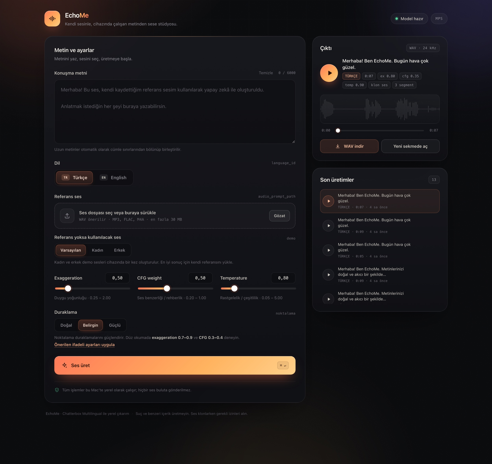

# EchoMe

**Kendi sesinle konuşan, tamamen cihazında çalışan metinden sese stüdyosu.**

EchoMe, [Chatterbox Multilingual TTS](https://github.com/resemble-ai/chatterbox)
modelini modern bir web arayüzüne sarar. Bir metin yaz, Türkçe veya İngilizce
seç, istersen kendi sesinden kısa bir referans yükle; ardından üretilen sesi
tarayıcıda dinle veya WAV olarak indir.

Ses dosyaları hiçbir bulut servisine gönderilmez. Model Mac'inde (Apple
Silicon'da MPS ile) çalışır; internete açsan bile çıkarım yerelde kalır.



---

## İçindekiler

- [Öne çıkanlar](#öne-çıkanlar)
- [Arayüz rehberi](#arayüz-rehberi)
  - [Konuşma metni](#1-konuşma-metni)
  - [Dil](#2-dil--language_id)
  - [Referans ses](#3-referans-ses--audio_prompt_path)
  - [Hazır ses seçimi](#hazır-ses-seçimi--voice)
  - [Exaggeration](#4-exaggeration)
  - [CFG weight](#5-cfg-weight)
  - [Temperature](#6-temperature)
  - [Duraklama](#7-duraklama)
  - [Ses üret ve iptal](#8-ses-üret-ve-iptal)
  - [Çıktı oynatıcı](#9-çıktı-oynatıcı)
  - [Son üretimler](#10-son-üretimler)
- [Parametre özeti](#parametre-özeti)
- [Nasıl çalışır?](#nasıl-çalışır)
- [Kurulum](#kurulum)
- [API](#api)
- [Yapılandırma](#yapılandırma)
- [İnternete açma](#i̇nternete-açma)
- [Sorun giderme](#sorun-giderme)
- [Etik ve lisans](#etik-ve-lisans)

---

## Öne çıkanlar

- 🎙️ **Metinden sese** — Chatterbox Multilingual, `tr` ve `en`
- 🗣️ **Ses klonlama** — WAV, MP3, FLAC, OGG veya M4A referans; otomatik olarak
  24 kHz mono WAV'a çevrilir
- 🗳️ **Hazır ses seçimi** — referans yüklemeden Varsayılan / Kadın / Erkek
  (demo sesler macOS'ta cihazın sistem seslerinden oluşturulur)
- 🎚️ **Üç ince ayar** — exaggeration, CFG weight ve temperature; kaydırıcı +
  elle giriş, 0.01 adım
- ⏸️ **Duraklama profili** — Doğal / Belirgin / Güçlü; noktalama duraklamalarını
  zorlar, düz okumayı engeller
- ✂️ **Uzun metin desteği** — noktalama sınırlarından parçalara bölünür, aralara
  seçilen duraklama profiline göre sessizlik eklenerek birleştirilir
- ⏱️ **Canlı geri bildirim** — aşama metni, geçen süre, segment sayacı ve iptal
- ▶️ **Özel oynatıcı** — dalga formu, konum çubuğu, yeni sekmede açma
- 💾 **WAV indirme** — 24 kHz, 16-bit PCM, tarih damgalı dosya adı
- 🕘 **Geçmiş** — son üretimler, parametre etiketleri ve silme
- 🔒 **Yerel çalışma** — model bir kez yüklenir, ses cihazdan çıkmaz
- 🔑 **İsteğe bağlı şifre** — internete açarken HTTP Basic koruması
- 🐳 **Docker** — Hugging Face Spaces / herhangi bir Docker host için hazır

---

## Arayüz rehberi

Arayüz iki sütundan oluşur: solda **metin ve ayarlar**, sağda **çıktı** ve
**son üretimler**. Dar ekranlarda tek sütuna iner.

### 1. Konuşma metni

Seslendirilecek metni buraya yazarsın.

- Sağ üstteki sayaç **0 / 6000** karakter sınırını gösterir; **Temizle** bağlantısı
  metni tek tıkla boşaltır.
- Metin boşsa üretim başlamaz; buton pasif kalır.
- **Metin noktalama sınırlarından bölünür.** Chatterbox tek seferde ~1000
  konuşma token'ı üretebildiği için metin cümlelere/parçalara ayrılır; her parça
  ayrı üretilir ve aralarına seçtiğin **Duraklama** profiline göre sessizlik
  eklenir. Uzun cümleler ~210 karakterlik parçalara bölünür; cümle ortasından
  bölünmemesi için önce virgül, sonra boşluk sınırı tercih edilir.

> İpucu: Noktalama işaretleri tonlamayı belirgin biçimde etkiler. Virgül kısa,
> nokta daha uzun duraklama yaratır; ünlem ve soru işareti ifadeyi canlandırır.

### 2. Dil · `language_id`

Modelin hangi dilde konuşacağını belirler.

- **TR — Türkçe** (varsayılan)
- **EN — English**

Bu değer doğrudan `model.generate(..., language_id="tr")` çağrısına gider.
Referans sesin dili ile metnin dili aynı olmak zorunda değildir; ancak en doğal
sonuç için ikisini uyumlu tutmak iyidir. Türkçe metinde `en` seçmek telaffuzu
bozar.

### 3. Referans ses · `audio_prompt_path`

Referans yüklemezsen hazır ses seçimi kullanılır. Kendi sesini (veya izinli
bir sesi) kullanmak için buraya bir kayıt bırak.

- **Kabul edilen biçimler:** WAV (önerilen), MP3, FLAC, OGG, M4A
- **Boyut:** en fazla 30 MB
- **Süre:** en az 0.6 saniye; ilk **20 saniyesi** kullanılır
- Dosyayı sürükle-bırak veya **Gözat** ile seç. Yüklendikten sonra ▶ ile
  referansı dinleyebilir, × ile kaldırabilirsin.
- Yükleme sonrası dosya tarayıcıda değil, sunucuda **24 kHz mono WAV**'a
  normalize edilir (librosa/soundfile; macOS'ta `afconvert` yedeği). Böylece
  model her formatı aynı biçimde görür.
- Boş bırakılırsa aşağıdaki **Hazır ses seçimi** kullanılır. Özel referans
  yüklendiğinde hazır ses seçimi devre dışı kalır.

> İyi referans: 5–15 saniye, sessiz ortam, tek konuşmacı, duygusal olarak nötr
> ve net bir kayıt. Arka plan müziği veya yankı klon kalitesini düşürür.

### Hazır ses seçimi · `voice`

Kendi referansını yüklemiyorsan **Varsayılan**, **Kadın** veya **Erkek**
arasından seçim yapabilirsin. Varsayılan, Chatterbox'un kendi `conds.pt`
sesidir; Chatterbox doğrudan kadın/erkek ses parametresi sunmaz. EchoMe diğer
iki seçim için Mac'te kurulu sistem sesleriyle bir kez kısa demo kayıtları
oluşturur ve bunları Chatterbox'a **yerel referans** olarak verir. Bu kayıtlar
`voices/` içinde kalır ve GitHub'a yüklenmez. Çıktı yine Chatterbox tarafından
üretilir; sistemin `say` sesinin doğrudan okunması değildir.

- **Kadın:** Mac'te varsa Türkçe Yelda; yoksa uygun İngilizce sistem sesi.
- **Erkek:** Mac'te varsa Daniel; yoksa uygun İngilizce sistem sesi. Türkçe
  metinlerde aksan/telaffuz değişebilir.
- Kendi referansını seçersen **her zaman o ses kullanılır**; hazır ses
  düğmeleri geçici olarak pasif olur. Referansı kaldırınca önceki hazır ses
  seçimine dönersin.
- `say` bulunmayan Linux / Docker ortamlarında, `voices/female.wav` ve
  `voices/male.wav` dosyalarını sen sağlamadıkça demo düğmeleri pasif olur.
  Varsayılan ve kendi referansını yükleme çalışmaya devam eder. Elle sağlanan
  demo kayıtlar da kısa, net ve 24 kHz mono WAV olmalıdır.

Bu seçimler ses tınısı için başlangıç noktalarıdır; modelin ürettiği ses
kesin olarak aynı çıkmayabilir. Daha iyi Türkçe erkek/kadın sesi istiyorsan
kendi izinli, net 5–15 saniyelik referans kaydını kullan.

### 4. Exaggeration

**Duygu yoğunluğu / ifade şiddeti.** Aralık **0.25 – 2.00**, varsayılan **0.50**.

Modelin duygusal ifade katmanını ölçekler: yüksek değerler daha canlı, abartılı
ve teatral bir okuma üretir; düşük değerler sakin ve düz bir ton verir.

- **0.25 – 0.50** — sakin, haber spikeri tonu; kurumsal içerik, eğitim
- **0.50 – 0.80** — doğal ve dengeli (önerilen başlangıç)
- **0.80 – 1.30** — belirgin duygu, hikâye anlatımı, reklam
- **1.30 – 2.00** — çok abartılı; kahkaha/bağırma gibi uç ifadelerde deneyin,
  aşırıya kaçarsa telaffuz bozulabilir

### 5. CFG weight

**Classifier-Free Guidance ağırlığı.** Aralık **0.20 – 1.00**, varsayılan
**0.50**.

Modelin metne ve referansa ne kadar "bağlı" kalacağını belirler:

- **Düşük (0.20 – 0.40)** — daha serbest, doğal ritim; bazen metinden sapma
- **0.45 – 0.60** — dengeli (önerilen)
- **Yüksek (0.70 – 1.00)** — metne çok sadık, referans tınısına daha yakın;
  aşırı yüksek değerlerde konuşma yavaşlar, sertleşir veya tekrara düşebilir

Chatterbox'un kendi arayüzünde bu parametre **0.5** civarında tutulur. Hızlı ve
akıcı konuşma için düşürmek, referansa daha sadık klon için yükseltmek işe
yarar.

### 6. Temperature

**Örnekleme rastgeleliği.** Aralık **0.05 – 5.00**, varsayılan **0.80**.

Model, bir sonraki konuşma token'ını olasılık dağılımından örnekler. Temperature
bu dağılımı ölçekler:

- **Düşük** → dağılım keskinleşir, en olası token'lar seçilir: kararlı,
  öngörülebilir, bazen tekdüze.
- **Yüksek** → dağılım düzleşir, alternatifler de seçilir: çeşitli ve ifadeli,
  ama telaffuz hatası / kelime atlama / anlamsız ses riski artar.

Pratik bantlar:

| Değer | Etki | Ne zaman? |
| --- | --- | --- |
| 0.05 – 0.50 | Çok stabil, düz | Bozuk veya tutarsız çıktılarda düşür |
| 0.70 – 1.00 | Doğal, dengeli | **Önerilen** (Türkçe için 0.80) |
| 1.20 – 2.00 | Daha heyecanlı, çeşitli | Yaratıcı denemeler; hata riski artar |
| 2.00 – 5.00 | Deneysel | Çoğu metinde anlamsız ses üretebilir |

Diğer iki parametreyle karıştırmamak için:

| Parametre | Neye tekabül eder |
| --- | --- |
| `exaggeration` | Duygu yoğunluğu / ifade şiddeti |
| `cfg_weight` | Metne ve referansa bağlılık, tempo |
| `temperature` | Örnekleme rastgeleliği, sürpriz payı |

### 7. Duraklama

Chatterbox'un SSML veya özel duraklama token'ı yoktur; noktalama duraklamalarını
model kendi inisiyatifiyle üretir. Bu yüzden düz okuma sorununu çözmek için
EchoMe metni **noktalama sınırlarından parçalara ayırır**, her parçayı ayrı
sentezler ve aralara ölçülü sessizlik ekler.

Üç profil vardır:

| Profil | Cümle sonu | Noktalı virgül / iki nokta | Virgül | Paragraf |
| --- | --- | --- | --- | --- |
| **Doğal** | ~0.18 sn | model | model | ~0.45 sn |
| **Belirgin** (varsayılan) | ~0.28 sn | ~0.16 sn | model | ~0.60 sn |
| **Güçlü** | ~0.40 sn | ~0.24 sn | ~0.14 sn | ~0.80 sn |

- **Doğal**: yalnızca cümle sonlarında ve paragraflarda kısa duraklama. En akıcı
  ve en hızlı seçenek.
- **Belirgin**: cümle sonlarına ek olarak `;` ve `:` duraklamalarını da zorlar.
  Günlük kullanım için dengeli.
- **Güçlü**: virgüllerde bile duraklama ekler. Sunum, hikâye, reklam gibi
  abartılı okumalarda işe yarar; çok sık virgül varsa konuşma kesik kesik
  duyulabilir.

Chatterbox'un kendi metin normalizasyonu `...`, `;` ve `:` işaretlerini
virgüle çevirdiği için EchoMe bunları ayrıca işler: üç nokta cümle sonu sayılır,
`;`/`:` ise güçlü duraklama noktası olur. Ondalık sayılar (`1,5`, `12:30`,
`3.14`) bozulmaz.

Tek tıkla denemek için **Önerilen ifadeli ayarları uygula** bağlantısı
exaggeration 0.80, CFG 0.35, temperature 0.90 ve **Belirgin** profilini seçer.

> Düz okuma hâlâ devam ederse: **CFG weight'i 0.30–0.40** aralığına indir,
> **exaggeration'ı 0.70–0.90** yap, temperature'ı 0.85–1.00 dene ve referans
> olarak duraklamaları belli, ifadeli bir kayıt kullan. Chatterbox'un kendi
> önerisi de budur: düşük CFG + yüksek exaggeration daha canlı ve tempolu
> konuşma üretir.

### 8. Ses üret ve iptal

**Ses üret** butonu işi kuyruğa alır. Üretim sırasında:

- Buton yerinde ekolayzer animasyonu ve **İptal** düğmesi görünür.
- Altta **aşama metni** ("Referans ses analiz ediliyor", "1/3 segment
  üretiliyor" vb.) ve **geçen süre** canlı güncellenir. Yüzde çubuğu yoktur;
  süre takibi daha dürüst bir beklenti verir.
- İptal, çalışan segment bittiğinde devreye girer (model tek parçayı atomik
  üretir).

Model ilk açılışta bir kez yüklenir (~20–60 sn). Sonraki üretimler doğrudan
başlar. Mac'te tipik hız: 5 saniyelik ses için ~25–50 saniye.

### 9. Çıktı oynatıcı

Üretim bitince ses otomatik olarak yüklenir.

- **▶ / ❚❚** — oynat / duraklat
- **Dalga formu** — dosyanın gerçek genliğinden çizilir
- **Konum çubuğu** — istediğin yere atla; süre `0:00 / 0:06` biçiminde
- **Etiketler** — dil, süre, `ex`, `cfg`, `temp`, `klon ses` / `varsayılan ses`
- **WAV indir** — 24 kHz 16-bit PCM, `echome_YYYYMMDD_HHMMSS.wav`
- **Yeni sekmede aç** — sesi tarayıcının kendi oynatıcısında açar

### 10. Son üretimler

Son üretimler en yeniden eskiye listelenir.

- Bir kayda tıkla → oynatıcıya yüklenir.
- **×** → kaydı hem listeden hem diskten siler.
- Her satırda metin önizlemesi, dil, süre ve ne kadar önce üretildiği görünür.
- Geçmiş `outputs/` klasöründeki `.wav` + `.json` çiftlerinden okunur; sunucu
  yeniden başlasa da korunur.

---

## Parametre özeti

| Arayüz | API alanı | Varsayılan | Aralık | Adım | Etki |
| --- | --- | --- | --- | --- | --- |
| Dil | `language_id` | `tr` | `tr`, `en` | — | Konuşma dili |
| Referans ses | `reference` | yok | WAV/MP3/FLAC/OGG/M4A, ≤30 MB | — | Ses klonu |
| Hazır ses | `voice` | `default` | `default`, `female`, `male` | — | Referans yüklenmediğinde ses seçimi |
| Exaggeration | `exaggeration` | `0.50` | 0.25 – 2.00 | 0.01 | Duygu yoğunluğu |
| CFG weight | `cfg_weight` | `0.50` | 0.20 – 1.00 | 0.01 | Metne/referansa bağlılık |
| Temperature | `temperature` | `0.80` | 0.05 – 5.00 | 0.01 | Örnekleme rastgeleliği |
| Duraklama | `pause_style` | `marked` | `natural`, `marked`, `strong` | — | Noktalama duraklamaları |

Tüm değerler tarayıcıda `localStorage`'a kaydedilir; sayfayı yenileyince son
ayarların korunur. Virgüllü ondalık giriş (`0,80`) de kabul edilir.

---

## Nasıl çalışır?

```
Tarayıcı (static/)
   │  multipart form: text, language_id, exaggeration,
   │  cfg_weight, temperature, pause_style, voice, reference dosyası
   ▼
FastAPI (server.py)
   │  doğrulama → referansı 24 kHz mono WAV'a normalize et
   │  iş kimliği + arka plan thread'i
   ▼
Chatterbox Multilingual (PyTorch, MPS/CPU)
   │  metni ~210 karakterlik parçalara böl
   │  her parça için model.generate(...)
   │  parçaları 0.16 sn sessizlikle birleştir
   ▼
outputs/<id>.wav + <id>.json
   │
   ▼
Tarayıcı: GET /api/jobs/{id} ile durum/süre, ardından sesi oynat/indir
```

- **Tek model örneği:** Model süreç başına bir kez yüklenir; ağırlıklar
  `~/.cache/huggingface` içinden okunur. Aynı anda tek üretim çalışır.
- **İş API'si:** Uzun süren üretim HTTP isteğini kilitlemez. Tarayıcı
  `GET /api/jobs/{id}` ile ilerlemeyi yoklar; iptal ayrı bir uç noktadır.
- **Koşullar (conditionals):** Chatterbox `generate()` çağrısı `self.conds`
  nesnesini değiştirir. Her işte referans varsa yeniden hazırlanır, yoksa
  modelin `conds.pt` içindeki varsayılanına dönülür; böylece önceki işin sesi
  sızmaz.
- **Parçalama ve duraklama:** Modelin ~1000 token sınırı nedeniyle metin
  cümlelere bölünür. `pause_style` seçimine göre cümle sonu, `;`/`:` ve (güçlü
  modda) virgül sonrasına sessizlik eklenir. Üç nokta cümle sonu sayılır;
  Chatterbox'un `punc_norm` fonksiyonu onu virgüle çevirse bile duraklama
  korunur. Çok uzun metinlerde segment sayısı 40 ile sınırlanır; komşu kısa
  segmentler birleştirilir.
- **Normalizasyon:** Referans ses 24 kHz mono'ya indirgenir; 20 saniyeden uzunu
  kırpılır. Bu, modelin beklediği biçimdir ve farklı dosya türlerini eşitler.
- **Çıktı:** 16-bit PCM WAV. Dosya adı indirme anında yerel saatle üretilir.

---

## Kurulum

### Gereksinimler

- macOS (Apple Silicon önerilir), Linux veya Windows
- Python **3.10+** (bu proje 3.11 ile test edildi)
- ~5 GB boş disk (PyTorch + model ağırlıkları)
- İlk çalıştırmada internet (model Hugging Face'ten iner)

### Hızlı başlangıç

```bash
git clone https://github.com/sarp-u/EchoMe.git
cd EchoMe
./run.sh
```

`run.sh` sırasıyla şu Python ortamlarını arar:

1. `./.venv`
2. `~/chatterbox_tr/venv` (varsa mevcut Chatterbox kurulumu)
3. Hiçbiri yoksa `./.venv` oluşturur ve `requirements.txt` ile kurar

Farklı bir ortamı zorlamak için:

```bash
CHATTERBOX_VENV=/yol/venv ./run.sh
```

Uygulama **http://127.0.0.1:8760** adresinde açılır. İlk açılışta model
yüklenirken arayüz "Model yükleniyor" durumunda bekler.

### Elle kurulum

```bash
python3 -m venv .venv
source .venv/bin/activate
pip install -r requirements.txt
python -m uvicorn server:app --host 127.0.0.1 --port 8760
```

### Docker

```bash
docker build -t echome .
docker run --rm -p 8760:8760 -e ECHOME_PASSWORD='güçlü-şifre' echome
```

İmaj CPU içindir ve model ağırlıklarını içerir (~6–7 GB). GPU'lu bir hostta
`CHATTERBOX_DEVICE=cuda` verebilirsin.

---

## API

| Yöntem | Yol | Açıklama |
| --- | --- | --- |
| `GET` | `/healthz` | Şifresiz sağlık kontrolü |
| `GET` | `/api/status` | Model durumu, cihaz, örnekleme hızı, hazır seslerin kullanılabilirliği, çıktı sayısı |
| `POST` | `/api/jobs` | Yeni üretim (multipart) |
| `GET` | `/api/jobs/{id}` | Durum, aşama, süre, sonuç |
| `POST` | `/api/jobs/{id}/cancel` | İptal isteği |
| `GET` | `/api/outputs` | Son üretimler |
| `GET` | `/api/audio/{id}` | WAV (satır içi oynatma) |
| `GET` | `/api/download/{id}` | WAV (attachment) |
| `DELETE` | `/api/outputs/{id}` | Kaydı sil |

`pause_style` alanı `natural`, `marked` (varsayılan) veya `strong` olabilir.
`voice` alanı `default` (varsayılan), `female` veya `male` olabilir. Dosya
gönderildiğinde `reference`, `voice` seçimini geçersiz kılar.

Örnek:

```bash
curl -F "text=Merhaba dünya, bu bir deneme." \
     -F "language_id=tr" \
     -F "exaggeration=0.5" \
     -F "cfg_weight=0.5" \
     -F "temperature=0.8" \
     -F "pause_style=marked" \
     -F "voice=female" \
     http://127.0.0.1:8760/api/jobs
```

Yanıt:

```json
{ "job_id": "ca853195865d4847990d1a3116bf1c63", "status": "queued" }
```

Durum yoklama:

```bash
curl http://127.0.0.1:8760/api/jobs/ca853195865d4847990d1a3116bf1c63
```

```json
{
  "status": "done",
  "stage": "Tamamlandı",
  "elapsed": 50.1,
  "result": {
    "url": "/api/audio/ca853195865d4847990d1a3116bf1c63",
    "download_url": "/api/download/ca853195865d4847990d1a3116bf1c63",
    "duration": 6.44,
    "language": "tr",
    "exaggeration": 0.5,
    "cfg_weight": 0.5,
    "temperature": 0.8
  }
}
```

Doğrulama hataları `400` ve Türkçe açıklama döner (geçersiz dil, aralık dışı
parametre, desteklenmeyen dosya türü, çok büyük/kısa referans).

---

## Yapılandırma

| Değişken | Varsayılan | Açıklama |
| --- | --- | --- |
| `PORT` | `8760` | HTTP portu |
| `HOST` | `127.0.0.1` | Dinlenecek adres |
| `CHATTERBOX_DEVICE` | `auto` | `auto`, `mps`, `cuda` veya `cpu` |
| `NO_OPEN` | `0` | `1` ise tarayıcı otomatik açılmaz |
| `ECHOME_PASSWORD` | boş | HTTP Basic şifresi (boşsa korumasız) |
| `ECHOME_USER` | `echome` | HTTP Basic kullanıcı adı |

Örnek:

```bash
PORT=9000 CHATTERBOX_DEVICE=cpu ./run.sh
ECHOME_PASSWORD='güçlü-şifre' ./run.sh
```

---

## İnternete açma

Ayrıntılı, ücretsiz seçenekler: **[DEPLOY.md](DEPLOY.md)**

| Yöntem | Maliyet | Hız | Kalıcılık |
| --- | --- | --- | --- |
| **Mac + Cloudflare Tunnel** | Ücretsiz | MPS ile en hızlı | Mac açık kaldıkça |
| **Hugging Face Spaces (Docker, CPU)** | PRO $9/ay | Dakikalar | Kalıcı URL, geçici disk |
| **Colab / Kaggle + tünel** | Ücretsiz GPU | Hızlı | Oturum bitince ölür |
| **Modal** | Aylık ücretsiz kredi | GPU ile hızlı | Sunucusuz |

En hızlısı:

```bash
brew install cloudflared
ECHOME_PASSWORD='güçlü-şifre' ./run.sh
# ikinci terminal:
cloudflared tunnel --url http://127.0.0.1:8760
```

> ⚠️ Herkese açık kullanımda **mutlaka** `ECHOME_PASSWORD` ayarla. Ses klonlama
> uç noktası korumasız bırakılırsa kötüye kullanılabilir. `/healthz` dışındaki
> tüm sayfalar ve API'ler şifreyle korunur.

Vercel, Netlify ve Cloudflare Pages yalnızca statik site barındırır; Python +
PyTorch + model çalıştıramaz. Render/Koyeb ücretsiz katmanlarının RAM'i modele
yetmez.

---

## Sorun giderme

| Belirti | Çözüm |
| --- | --- |
| Model yüklenmiyor | İlk indirme için internet gerekir; `~/.cache/huggingface` izinlerini kontrol et |
| `MPS` hatası | `CHATTERBOX_DEVICE=cpu ./run.sh` ile dene |
| Referans reddedildi | 0.6 sn–30 MB aralığında, desteklenen bir biçim kullan |
| Ses bozuk / tekrarlı | Temperature'ı 0.5'e düşür, CFG'yi 0.5 civarında tut |
| Konuşma çok düz | Exaggeration'ı 0.8–1.2 aralığına çıkar |
| Üretim çok yavaş | CPU'ya düşmüş olabilir; `status` yanıtındaki `device` alanına bak |
| Port dolu | `PORT=9000 ./run.sh` veya `lsof -ti :8760 \| xargs kill` |
| Şifre soruluyor | `ECHOME_PASSWORD` boş değil; kullanıcı adı `ECHOME_USER` |

---

## Etik ve lisans

- Bu araç yalnızca **kendi sesin** veya **açık izin verilen** seslerle
  kullanılmalıdır.
- Dolandırıcılık, taklit, nefret söylemi veya yanıltıcı içerik üretmeyin.
- Üretilen seslerde yapay zekâ olduğunu belirtmek iyi bir uygulamadır.
- Model: [Resemble AI — Chatterbox](https://github.com/resemble-ai/chatterbox)
  (MIT lisansı). Model ağırlıkları Hugging Face üzerinden dağıtılır.
- Bu depodaki uygulama kodu MIT lisansı altındadır.

---

<p align="center">
  <sub>EchoMe — yerel, gizliliğe saygılı metinden sese.</sub>
</p>
